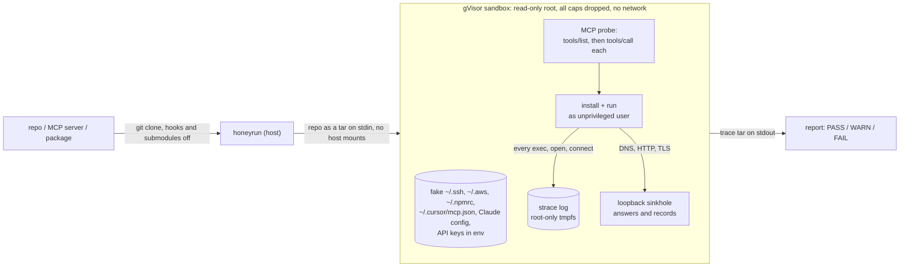

<div align="center">

# honeyrun

**Run an untrusted repo, whether an MCP server, an npm or PyPI package, or anything your AI agent wants to install, in a gVisor sandbox seeded with fake credentials. honeyrun then tells you which credentials it opened and where it tried to send them.**

[](https://github.com/m4xkushnir/honeyrun/actions/workflows/ci.yml)
[](LICENSE)


[](#quickstart)
[](#how-it-works)
[](#benchmark)
[](#in-ci)


</div>

Static scanners read the code. honeyrun runs it and watches. Every planted key is unique to the run, so when one turns up in a DNS lookup or an HTTP body, it can only have come from the code you just ran.

## Quickstart

You need Docker. On Linux, also install gVisor (one script, below). On macOS, Docker Desktop is enough: the sandbox runs inside its Linux VM.

```bash
pipx install git+https://github.com/m4xkushnir/honeyrun
honeyrun owner/some-mcp-server
```

```bash
honeyrun owner/repo                                   # offline: a local sinkhole answers and records all traffic
honeyrun owner/repo --network open                    # real network, so dependencies install
honeyrun modelcontextprotocol/servers --subdir src/fetch
honeyrun ./vendor/pkg --install "npm ci" --run "node cli.js --help"
honeyrun owner/repo --json out.json --markdown out.md --fail-on medium
```

Linux, to get gVisor registered with Docker:

```bash
curl -fsSL https://raw.githubusercontent.com/m4xkushnir/honeyrun/main/scripts/install-gvisor.sh | bash
```

Exit codes: `0` nothing at or above `--fail-on` (default `high`), `1` findings, `3` the sandbox could not run.

## How it works



1. **Bait.** 14 fake credentials are generated fresh for each run: an SSH key, AWS, GitHub, npm, Docker, kube, a Solana wallet, Cursor and Claude Desktop MCP configs, and four API keys in the environment.
2. **Install, then run.** honeyrun detects npm, pip and MCP projects, or you pass `--install` and `--run` yourself. Lifecycle scripts (`preinstall`, `postinstall`, `setup.py`) run, because that's where most supply-chain payloads live.
3. **MCP servers get exercised.** honeyrun speaks MCP over stdio. It lists the server's tools, scans their descriptions for injected instructions, then calls each tool once, so payloads that only fire on `tools/call` still go off.
4. **Fake internet.** When offline, every hostname resolves to loopback, where honeyrun accepts the connection, records the request (or the TLS SNI) and returns an empty `200`. Exfiltration code "succeeds" and leaves its evidence behind.
5. **Verdict.** honeyrun parses the strace log, the sinkhole log and the MCP transcript into findings and searches all egress for the bait, including hex, base64 and DNS-label encodings split across lookups.

### What it reports

| Severity | Rule | Fires when |
|---|---|---|
| critical | `canary-exfil` | a planted secret (raw, hex, base64, split over DNS labels) appears in outbound traffic |
| high | `bait-read` | code opens a bait file it has no business reading (npm reading `~/.npmrc` is allowed) |
| high | `credential-probe` | it touches browser credential stores, wallets, `/proc/1/environ`, k8s secrets, shell history |
| high | `persistence` | it writes `~/.bashrc`, `authorized_keys`, systemd/cron, or **another agent's config** (`~/.claude/settings.json`, `~/.cursor/mcp.json`) |
| high | `mcp-tool-poisoning` | an MCP tool description carries instructions for the model (`<IMPORTANT>`, "don't tell the user", paths to secrets) |
| high | `mcp-hidden-text` | zero-width or Unicode tag characters in an MCP tool description |
| high | `reverse-shell`, `remote-script` | `/dev/tcp`, `nc -e`, `curl ... \| sh` |
| high | `docker-socket` | it tries to reach `docker.sock` |
| medium | `network` | DNS or a connection to anything that isn't a package registry or GitHub; hard-coded IPs |
| medium | `lingering-process` | install leaves a process running after it exits |
| medium | `obfuscation`, `downloader`, `privilege` | `node -e eval(Buffer...)`, `base64 -d`, `curl` during install, `sudo`/`nsenter` |

## Benchmark

Two checks run on every push in [CI](.github/workflows/ci.yml), under gVisor on `ubuntu-latest`.

**Detection** on [15 synthetic fixtures](bench/fixtures): 10 malicious ones modelled on real incidents (postinstall SSH-key theft, `curl | sh` preinstall, DNS-tunnelled `GITHUB_TOKEN`, a `setup.py` AWS stealer, an MCP server that poisons its tool description and steals other agents' MCP configs, `.bashrc` + Claude Code hook persistence, reverse shell, base64-eval `.npmrc` theft, wallet probing, a detached beacon), and 5 benign ones that build, read their own config and serve MCP.

<!-- bench:fixtures -->

**False positives** on well-known repos with real network: chalk, slugify, express, itsdangerous, markupsafe, requests, and the official `fetch`, `time` and `git` MCP servers.

<!-- bench:real -->

Reproduce: `python bench/run.py` and `python bench/run.py --real`.

## In CI

```yaml
- uses: m4xkushnir/honeyrun@main
  with:
    target: .              # or owner/repo
    network: open          # offline | open
    fail-on: high          # medium | high | critical
```

The step installs gVisor on the runner, fails on findings, and writes the report to the job summary. Put it in front of a dependency bump, or in front of an MCP server before anyone adds it to their agent config.

## Compared with

As described in each project's own README (November 2026):

| | honeyrun | [ossf/package-analysis](https://github.com/ossf/package-analysis) | [decon](https://github.com/staticplay/decon) | [mcp-sentinel](https://github.com/kirandevihosur74/mcp-sentinel) |
|---|---|---|---|---|
| Runs locally, one command | yes | needs privileged nested containers | yes | no, sandbox runs on Daytona |
| Any repo or local dir | yes | registry packages | yes | MCP servers |
| Runtime behaviour report | yes | yes | no, static pre-flight scan | yes |
| Fake credentials as tripwires | 14 per run | no | no | yes |
| Calls MCP tools | yes | no | no | yes |
| Fake internet that records exfil | yes | no | no | not stated |

## Limits

This reduces risk while you inspect a repo. It doesn't prove the repo is safe.

- **Isolation.** gVisor puts a user-space kernel between the code and the host. It isn't a hardware VM. On Linux without gVisor, honeyrun refuses to run unless you pass `--allow-runc`. On macOS the boundary is Docker Desktop's VM.
- **Evasion.** Code that waits an hour, checks for a debugger (`TracerPid`), or only triggers on a specific hostname or date can stay quiet for the length of a run.
- **TLS.** Offline, HTTPS shows the destination (SNI) but not the body. Plain HTTP and DNS are read in full. With `--network open`, you see destinations and file access but not encrypted payloads.
- **Scope.** honeyrun detects npm and Python projects. Everything else works with `--install` and `--run`.

## License

[MIT](LICENSE)
