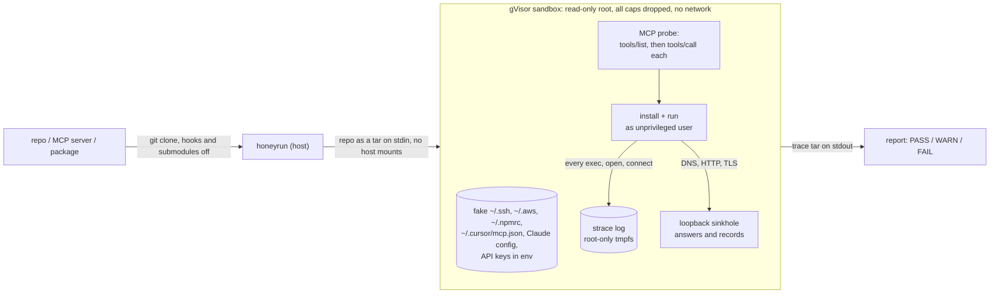

<div align="center">

# honeyrun

**Run an untrusted repo, or anything your AI agent wants to install, in a hardened gVisor sandbox seeded with fake credentials. honeyrun then tells you what it opened, ran and changed, and where it tried to send it.**

[](https://github.com/m4xkushnir/honeyrun/actions/workflows/ci.yml)
[](LICENSE)


[](#quickstart)
[](#how-it-works)
[](#benchmark)
[](#in-ci)


</div>

Static scanners read the code. honeyrun reads it too, then runs it and watches: every process, file, connection, hook and change outside the project. Every planted key is unique to the run, so when one turns up in a DNS lookup, an HTTPS body or a log line, it can only have come from the code you just ran.

## Quickstart

You need Docker. On Linux, also install gVisor (one script, below). On macOS, Docker Desktop is enough: the sandbox runs inside its Linux VM.

```bash
pipx install git+https://github.com/m4xkushnir/honeyrun
honeyrun owner/some-mcp-server
```

```bash
honeyrun owner/repo                                   # offline: a local sinkhole answers and records all traffic
honeyrun owner/repo --network open                    # real network, so dependencies install
honeyrun modelcontextprotocol/servers --subdir src/fetch
honeyrun ./vendor/pkg --install "npm ci" --run "node cli.js --help"
honeyrun owner/repo --json out.json --markdown out.md --fail-on medium
honeyrun owner/repo --static-only                     # seconds, no Docker: hooks, manifests, agent configs
```

Linux, to get gVisor registered with Docker:

```bash
curl -fsSL https://raw.githubusercontent.com/m4xkushnir/honeyrun/main/scripts/install-gvisor.sh | bash
```

Exit codes: `0` nothing at or above `--fail-on` (default `high`), `1` findings, `3` the sandbox could not run.

## How it works



1. **Bait.** 18 fake credentials are generated fresh for each run: an SSH key, AWS, GitHub, npm, Docker, kube, a Solana wallet, Claude Code, Codex, Gemini CLI, Cursor, Windsurf and Claude Desktop configs, and four API keys in the environment.
2. **Install, then run.** honeyrun detects npm, pip and MCP projects, or you pass `--install` and `--run` yourself. Lifecycle scripts (`preinstall`, `postinstall`, `setup.py`) run, because that's where most supply-chain payloads live.
3. **MCP servers get exercised.** honeyrun speaks MCP over stdio. It lists the server's tools, scans their descriptions for injected instructions, then calls each tool once, so payloads that only fire on `tools/call` still go off.
4. **Fake internet.** When offline, every hostname resolves to loopback. honeyrun accepts the connection, terminates TLS with a per-run CA the sandbox trusts, records the request and returns an empty `200`. Exfiltration code "succeeds" and leaves its evidence behind.
5. **Verdict.** honeyrun parses the strace log, the sinkhole log and the MCP transcript into findings and searches all egress for the bait, including hex, base64 and DNS-label encodings split across lookups.

### What it checks

**Before anything runs** (static, seconds, no AI). These are the places where a repo runs code without asking:

| Where | What honeyrun looks for |
|---|---|
| Install hooks | `preinstall`/`postinstall`/`prepare`, `setup.py`, in-tree build backends, `binding.gyp`, graded by what the command does |
| Auto-run on open | VS Code `folderOpen` tasks, devcontainer `initializeCommand` (runs on the host), `.envrc`, `.pth` and `sitecustomize.py`, git hooks |
| AI agents | Claude Code, Codex, Gemini CLI and Cursor hooks, `Bash(*)` pre-approval, auto-approved project MCP servers (`.mcp.json`, `.cursor/mcp.json`, `.vscode/mcp.json`, `.codex/config.toml`), Claude Code plugin manifests, MCP manifests |
| Instructions for models | `AGENTS.md`, `CLAUDE.md`, `GEMINI.md`, `.cursorrules`, Copilot instructions, skills, commands, and tool descriptions in source: injected orders and invisible Unicode |
| Source tricks | Trojan-Source bidi characters, large encoded blobs |

**While it runs** (strace, sinkhole, before/after filesystem snapshot):

| Severity | Rule | Fires when |
|---|---|---|
| critical | `canary-exfil` | a planted secret (raw, hex, base64, base32, reversed, split over DNS labels) leaves over DNS, HTTP or intercepted HTTPS |
| high | `bait-read`, `bait-tamper` | code opens, rewrites or deletes one of the 18 fake credentials (SSH, AWS, GitHub, npm, Docker, kube, wallet, and Claude Code, Codex, Gemini, Cursor and Windsurf configs) |
| high | `secret-in-output` | it prints a credential into its own output, which CI logs keep |
| high | `credential-probe` | browser credential stores, wallets, other processes' memory or environment, k8s secrets, shell history |
| high | `persistence` | writes to shell startup files, `authorized_keys`, systemd/cron, `~/.npmrc` or pip config, editor extensions, **another agent's config or hooks** |
| high | `dropped-binary`, `auto-exec` | an ELF/Mach-O/PE dropped outside the project, a `.pth` file that runs at every Python start |
| high | `wiper` | most of the repo's own files deleted or rewritten |
| high | `fileless-exec`, `escape-attempt` | exec from memfd or `/dev/shm`, `setns`/`mount`/kernel module calls |
| high | `reverse-shell`, `remote-script`, `crypto-miner`, `docker-socket` | `/dev/tcp`, `nc -e`, `curl \| sh`, stratum pools, `docker.sock` |
| high | `mcp-tool-poisoning`, `mcp-result-injection` | MCP tool descriptions or tool results carrying instructions for the model, hidden Unicode |
| medium | `network`, `listener` | contact with anything that isn't a package registry or code host, hard-coded IPs, a port opened during install |
| medium | `outside-workspace`, `lingering-process` | files changed outside the project, processes left running after install |
| medium | `sandbox-detection`, `obfuscation`, `downloader`, `privilege` | probing `/.dockerenv` or ptrace, `eval(Buffer...)`, `base64 -d`, `curl`, `sudo`/`nsenter` |
| medium | `incomplete` | install failed or timed out, MCP server never answered, evidence truncated: a quiet run is never reported as clean |

## Works with any coding agent

`--agent` prints a dozen plain lines (verdict, top findings, one `next:` line), so an agent spends a few hundred tokens instead of reading a trace.

- **Claude Code**: copy [`integrations/claude-code/honeyrun`](integrations/claude-code/honeyrun) into `~/.claude/skills/`.
- **Codex, Cursor, Gemini CLI, Copilot, Windsurf**: paste [`integrations/AGENTS.md`](integrations/AGENTS.md) into your `AGENTS.md`, `GEMINI.md` or rules file.

**AI only where it adds something.** The verdict comes from deterministic rules. With `--review "claude -p"` (or `"codex exec -"`, or `"gemini -p {prompt_file}"`), an AI is asked for a second opinion **only on WARN runs**, and it gets about 6 KB of pre-filtered evidence. Registry traffic, package caches and a package manager reading its own config are dropped first. PASS and FAIL runs cost zero tokens. The reviewer's answer is advisory and never changes the exit code, because the evidence it reads was written by the code under test.

## Benchmark

Both checks run on every push in [CI](.github/workflows/ci.yml), under gVisor on `ubuntu-latest`. The numbers below come from those runs.

**Detection** on [15 synthetic fixtures](bench/fixtures): 10 malicious ones modelled on real incidents (postinstall SSH-key theft, `curl | sh` preinstall, DNS-tunnelled `GITHUB_TOKEN`, a `setup.py` AWS stealer, an MCP server that poisons its tool description and steals other agents' MCP configs, `.bashrc` + Claude Code hook persistence, reverse shell, base64-eval `.npmrc` theft, wallet probing, a detached beacon), and 5 benign ones that build, read their own config and serve MCP.

| Malicious flagged | Benign flagged | Exact rule match | Median time per run |
|:---:|:---:|:---:|:---:|
| **10 / 10** | **0 / 5** | **15 / 15** | **1.6 s** |

<details>
<summary>Per fixture</summary>

| Fixture | Verdict | Rules fired |
|---|---|---|
| `mal-mcp-config-stealer` | FAIL | canary-exfil, bait-read, mcp-tool-poisoning, network |
| `mal-npm-ssh-exfil` | FAIL | canary-exfil, bait-read, network |
| `mal-npm-env-dns` | FAIL | canary-exfil, network |
| `mal-npm-obfuscated-npmrc` | FAIL | canary-exfil, bait-read, obfuscation, network |
| `mal-py-setup-aws` | FAIL | canary-exfil, bait-read, network |
| `mal-py-wallet-probe` | FAIL | bait-read, credential-probe |
| `mal-npm-persistence` | FAIL | persistence |
| `mal-npm-curl-sh` | FAIL | remote-script, downloader, network |
| `mal-npm-revshell` | FAIL | reverse-shell, network |
| `mal-npm-daemon` | WARN | lingering-process, network |
| `ok-mcp-server`, `ok-npm-build`, `ok-npm-cli`, `ok-py-package`, `ok-py-script` | PASS | none |

</details>

**False positives** on well-known repos with real network: chalk, slugify, express, itsdangerous, markupsafe, requests, and the official `fetch`, `time` and `git` MCP servers.

| Repo | Install | Run | MCP tools called | Verdict |
|---|:---:|:---:|:---:|:---:|
| chalk/chalk | ok | | | PASS |
| sindresorhus/slugify | ok | ok | | PASS |
| expressjs/express | ok | ok | | PASS |
| pallets/itsdangerous | ok | | | PASS |
| pallets/markupsafe | ok | | | PASS |
| psf/requests | ok | | | PASS |
| modelcontextprotocol/servers `src/fetch` | ok | ok | 1 | PASS |
| modelcontextprotocol/servers `src/time` | ok | ok | 2 | PASS |
| modelcontextprotocol/servers `src/git` | ok | ok | 12 | PASS |

**0 / 9 flagged**, with every install succeeding. The check fails CI if one doesn't, so a PASS can't hide a broken run.

Reproduce: `python bench/run.py` and `python bench/run.py --real`.

## In CI

```yaml
- uses: m4xkushnir/honeyrun@main
  with:
    target: .              # or owner/repo
    network: open          # offline | open
    fail-on: high          # medium | high | critical
```

The step installs gVisor on the runner, fails on findings, and writes the report to the job summary. Put it in front of a dependency bump, or in front of an MCP server before anyone adds it to their agent config.

## Compared with

As described in each project's own README (November 2026):

| | honeyrun | [ossf/package-analysis](https://github.com/ossf/package-analysis) | [decon](https://github.com/staticplay/decon) | [mcp-sentinel](https://github.com/kirandevihosur74/mcp-sentinel) |
|---|---|---|---|---|
| Runs locally, one command | yes | needs privileged nested containers | yes | no, sandbox runs on Daytona |
| Any repo or local dir | yes | registry packages | yes | MCP servers |
| Runtime behaviour report | yes | yes | no, static pre-flight scan | yes |
| Fake credentials as tripwires | 18 per run | no | no | yes |
| Calls MCP tools | yes | no | no | yes |
| Fake internet that records exfil (incl. HTTPS) | yes | no | no | not stated |

## Limits

This reduces risk while you inspect a repo. It doesn't prove the repo is safe.

- **Isolation.** gVisor puts a user-space kernel between the code and the host. It isn't a hardware VM. On Linux without gVisor, honeyrun refuses to run unless you pass `--allow-runc`. On macOS the boundary is Docker Desktop's VM.
- **Evasion.** Code that waits an hour, checks for a debugger (`TracerPid`), or only triggers on a specific hostname or date can stay quiet for the length of a run.
- **TLS.** Offline, HTTPS is intercepted with a per-run CA that the sandbox trusts through the usual environment variables. Code that pins certificates or ships its own CA store shows only the destination (SNI). With `--network open`, you see destinations, files and processes but not encrypted payloads.
- **Fingerprints.** A determined sample can still tell it's in a container. honeyrun reports those probes (`sandbox-detection`) rather than hiding from them.
- **Scope.** honeyrun detects npm and Python projects. Everything else works with `--install` and `--run`.

## License

[MIT](LICENSE)
